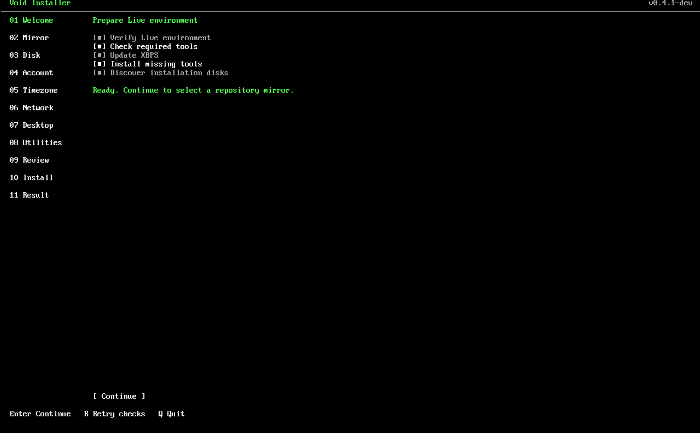
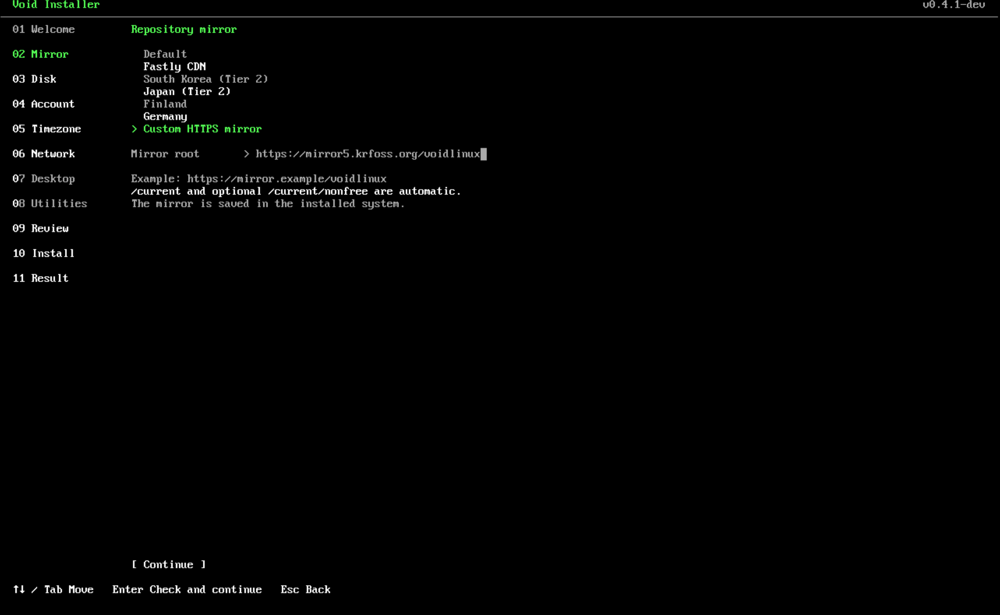
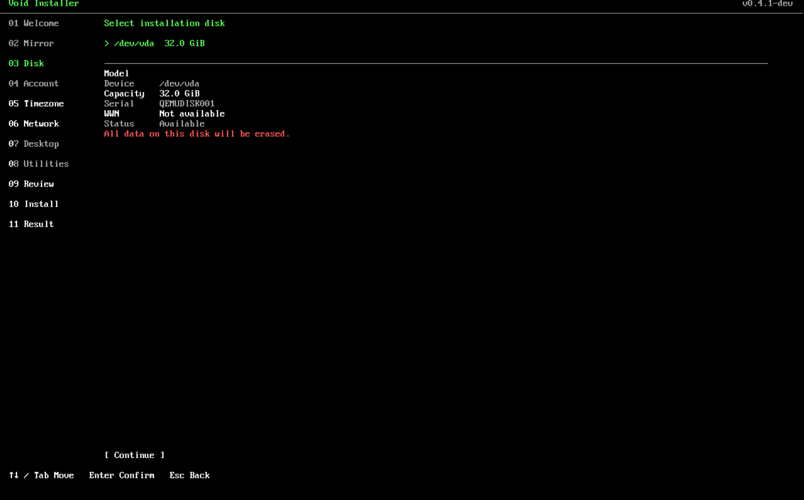
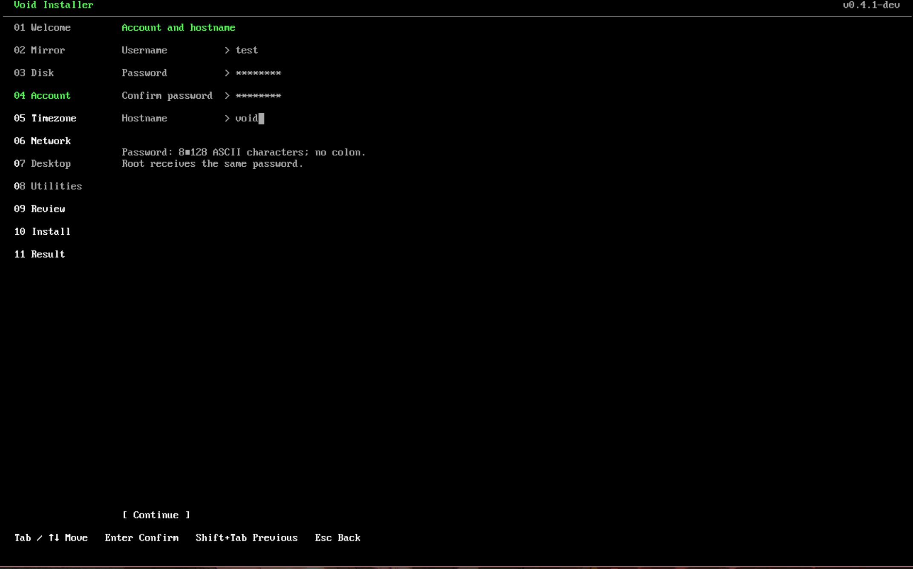
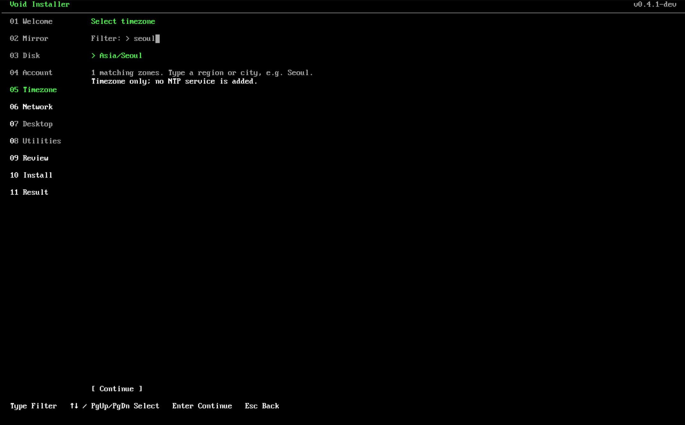
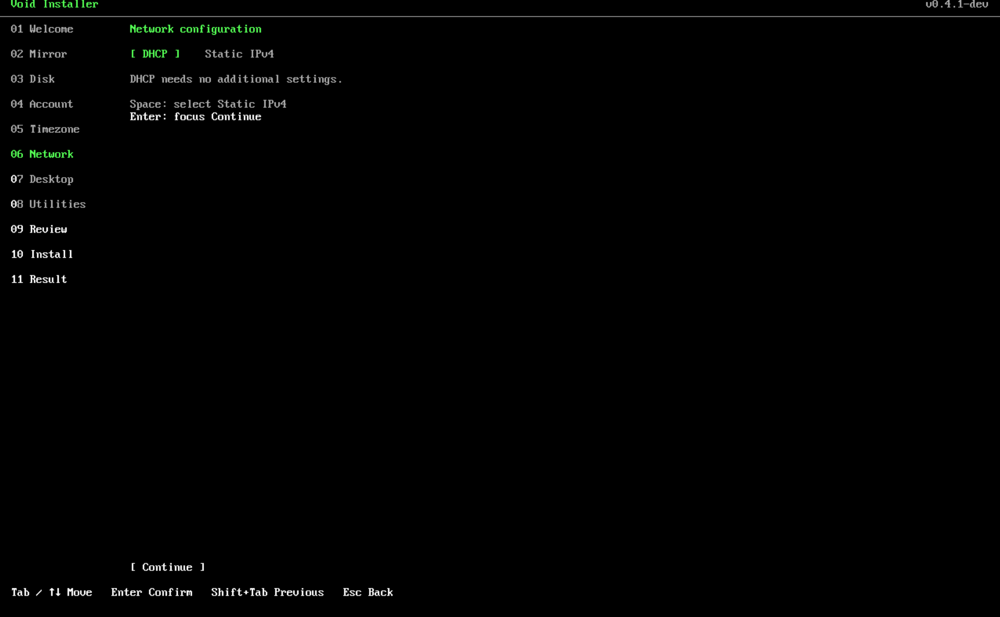
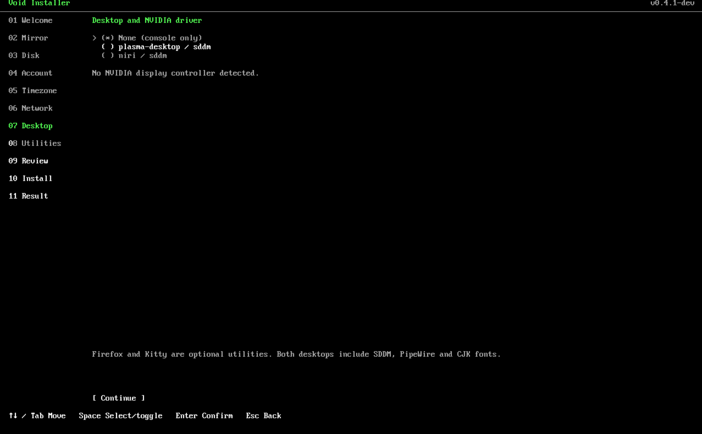
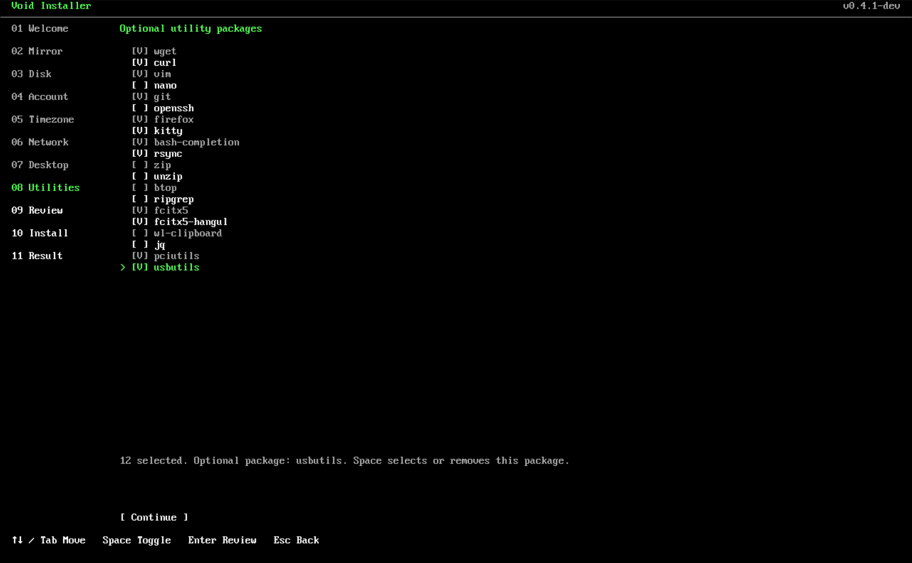
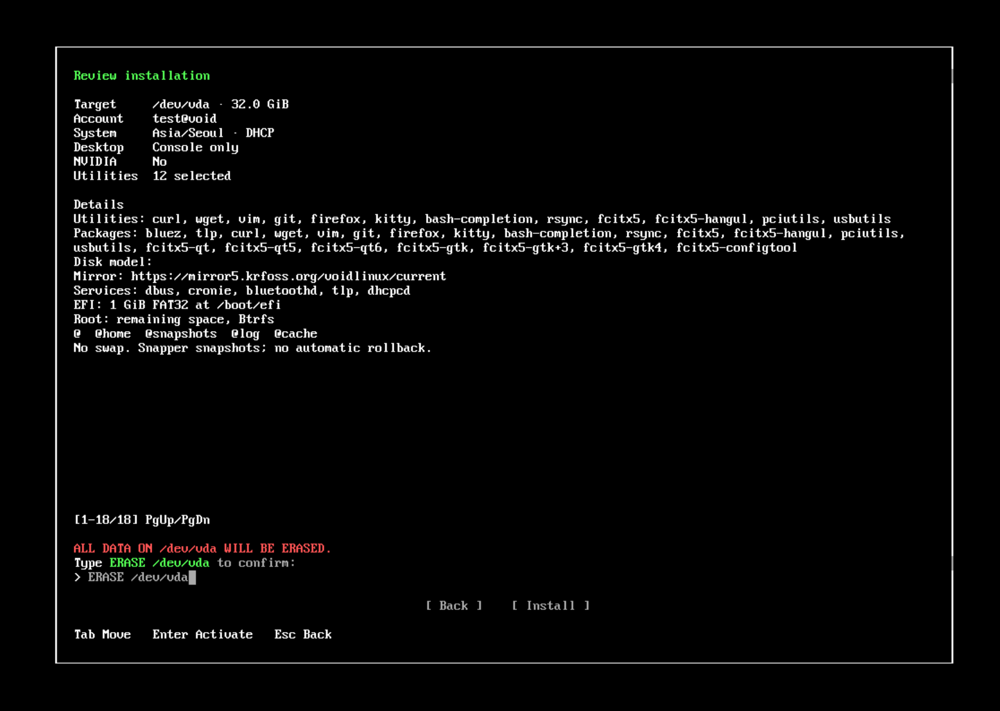

[한국어](README_ko.md) | English

# Void Linux TUI Installer (Unofficial)

An installer for the official Void Linux Live ISO, built with a Go/Bubble Tea v2 TUI and a Bash installation engine. The target system uses x86_64 glibc, UEFI/GPT, GRUB and Btrfs.

<details>
<summary>Screenshots</summary>
<ul>
  <li><p>1. Welcome and Live environment preparation</p></li>
  <li><p>2. Repository mirror</p></li>
  <li><p>3. Installation disk</p></li>
  <li><p>4. Account and hostname</p></li>
  <li><p>5. Timezone</p></li>
  <li><p>6. Network</p></li>
  <li><p>7. Desktop</p></li>
  <li><p>8. Utilities</p></li>
  <li><p>9. Review and erase confirmation</p></li>
</ul>
</details>

## Disclaimer

You are responsible for deciding whether to use this installer and for the consequences of doing so. The authors accept no responsibility for problems resulting from its use.

The test environments are an HP Victus 15 (15-fa0051tx, i5-12450H/RTX 3050 Laptop GPU) and QEMU VMs. Results may differ on other systems, and unexpected problems may occur. See the [validation record](docs/testing.md) for the test coverage and unverified cases documented in this repository.

Installation erases the selected disk. The exact `ERASE <disk>` confirmation is required, and disk identity and activity are rechecked before each partitioning or formatting command. Keep storage devices connected and avoid other disk operations until installation finishes; these checks cannot make hardware changes atomic. Diagnostic logs remove terminal control sequences and redact the supplied password.

## Dependencies

The installer requires these packages:

- `xbps`
- `jq`
- `gptfdisk`
- `parted`
- `dosfstools`
- `btrfs-progs`
- `psmisc`

XBPS and the standard Live environment tools must already be available. If other installation tools are missing or cannot be found, the welcome screen updates XBPS first and installs the required packages automatically. If all tools are present, it skips package installation. You can also prepare the tools manually with the separate script (`bash ./pkg-install.sh`). Package installation uses the Live environment's configured repositories and requires an already working network connection.

## Usage

### Build

On a development machine, install Go 1.26 or newer, Git and Make, then clone the repository and build:

```sh
git clone https://github.com/kmw0410/void-tui-installer.git
cd void-tui-installer
make build
```

This produces a statically linked Linux amd64 executable at `dist/void-installer-tui`, the manual preparation helper `dist/pkg-install.sh`, and `dist/SHA256SUMS`. Copy the executable to the Live environment; Go, Git and the source files are not required there. To run development checks, also install Bash, jq, ShellCheck and a C compiler:

```sh
make check
go test -race ./...
```

### Run

Boot the official x86_64 glibc Live ISO in UEFI mode, disable Secure Boot, and connect to the network. Run the installer as root in a terminal of at least 80×24.

You can use a binary from Releases instead of building locally. Download its matching `SHA256SUMS`, verify it with `sha256sum -c SHA256SUMS`, and substitute the versioned filename (for example `void-tui-installer-v0.4.0-1`) for `void-installer-tui` in the commands below.

In the directory containing the copied executable, make it runnable and start it:

```sh
chmod +x ./void-installer-tui
./void-installer-tui
```

The `--check` option only checks the Live environment and repository access/package resolution for the base installation. It does not install dependencies, so use it after initial preparation:

```sh
./void-installer-tui --check
```

**Installation erases all data on the selected disk.** In Review, type `ERASE /dev/DEVICE` exactly and activate the `Install` button to start installation.

If a VM reports `Stable serial or WWN is required`, shut it down completely, assign a unique serial such as `VOIDTEST001` to the installation disk, and boot it again. In virt-manager/libvirt XML, add `<serial>VOIDTEST001</serial>` inside the relevant `<disk device='disk'>` element. Verify it in the Live environment with:

```sh
lsblk -d -o NAME,SIZE,TYPE,SERIAL,WWN
```

## Installation flow

Follow Welcome → Mirror → Disk → Account → Timezone → Network → Desktop → Utilities → Review. In Timezone, type a city or region, navigate with the arrow keys or PageUp/PageDown, and press Enter to select a timezone such as `Asia/Seoul`. The default is UTC; no NTP service is added.

Use arrows or Tab/Shift+Tab to move, Space to select or toggle, Enter to confirm, and Esc to go back. The final Review appears as a rectangular dialog centered on a black background. PageUp/PageDown scrolls the summary while the erase-confirmation field and Back/Install buttons stay visible. Enter in the field focuses Install; press Enter again on that button to start installation.

Welcome shows each preparation step as running, completed, skipped or failed. Settings screens keep Continue in the same bottom position; Tab focuses it from a selection list, while Enter confirms the current selection and continues. In account and static-network forms, Enter moves through inputs to Continue before submitting. Invalid input is explained below its field. Disk selection separates the list from model, capacity, serial/WWN and blocker details; D on a failed Welcome opens inspection only. Desktop and Utilities keep descriptions below the choices. Review puts the selected desktop, driver and utility count above package/service/storage details. Installation shows the latest few sanitized log lines, with F2 opening the full log.

## Installation profiles

Choose console-only (CLI), KDE Plasma or Niri. KDE Plasma installs `plasma-desktop`, `sddm`, `kwallet-pam`, `kf6-kwallet` and related packages. Niri installs `niri`, `sddm`, `xdg-desktop-portal-gnome`, `gnome-keyring`, `seahorse` and other packages needed for the session.

Every profile, including CLI, installs `bluez` and `tlp` and enables the `bluetoothd` and `tlp` runit services.

Both desktop profiles include `pipewire`, `wireplumber`, `libjack-pipewire` and `alsa-pipewire` by default. Firefox and Kitty are not installed automatically; select them in Utilities.

## Utilities

Select utilities through individual checkboxes labeled with their actual package names: `wget`, `curl`, `vim`, `nano`, `git`, `openssh`, `firefox`, `kitty`, `bash-completion`, `rsync`, `zip`, `unzip`, `btop`, `ripgrep`, `fcitx5`, `fcitx5-hangul`, `wl-clipboard`, `jq`, `pciutils` and `usbutils`.

Selecting `fcitx5` also installs `fcitx5-qt`, `fcitx5-qt5`, `fcitx5-qt6`, `fcitx5-gtk`, `fcitx5-gtk+3`, `fcitx5-gtk4` and `fcitx5-configtool`. Selecting only `fcitx5-hangul` installs the same bundle and creates an English/Hangul input profile. Installing `openssh` does not automatically enable the `sshd` service.

## Default Niri key bindings

Niri provides the following launch shortcuts. Mod means the Super key, usually the Windows key. Firefox and Kitty shortcuts are added only when their packages are selected in Utilities.

- `Mod` + `B`: launch Firefox
- `Mod` + `Enter`: launch Kitty
- `Mod` + `Shift` + `E`: exit the session

## NVIDIA GPUs

NVIDIA display controllers are detected automatically, including secondary GPUs. In Desktop, move to the `[ ] Install NVIDIA driver` checkbox and press Space to enable it (`[V]`) and include the driver. This option is independent of the desktop selection.

The option adds the nonfree repository and `linux-headers`. Before erasure, the installer checks whether the detected GPUs are supported by the repository's driver version. Unsupported or unverifiable hardware blocks installation. Legacy drivers are not selected automatically.

## Installed layout

| Partition / subvolume | Mount | Configuration |
| --- | --- | --- |
| EFI, 1 GiB FAT32 | `/boot/efi` | GRUB UEFI and fallback loader |
| Remaining space, Btrfs `@` | `/` | `noatime,compress=zstd:3` |
| `@home` | `/home` | Same Btrfs filesystem |
| `@snapshots` | `/.snapshots` | Root-only Snapper storage |
| `@log` | `/var/log` | Excluded from root snapshots |
| `@cache` | `/var/cache` | Excluded from root snapshots |

The root filesystem and root GPT partition have no label. `/etc/fstab` uses UUIDs. No swap, encryption, dual boot or custom partitioning is provided. GRUB explicitly boots `subvol=@`; the default Btrfs subvolume stays unchanged. The engine verifies EFI files, GRUB configuration, matching kernel/initramfs files, mounts, accounts, sudo, packages, selected graphical configuration and Snapper before unmounting the target.

Snapper creates an initial root snapshot and uses Void's packaged hourly cron helper with cronie and D-Bus. Timeline retention is 5 hourly, 7 daily, 4 weekly, 3 monthly and 0 yearly. The engine creates the Snapper configuration before mounting the separate `@snapshots` subvolume to avoid an existing-directory conflict. Home, logs, cache and EFI contents are outside root snapshots. **Automatic rollback, restoration tools and grub-btrfs integration are not provided.** Snapper's default-subvolume rollback does not switch the explicit `subvol=@` boot root.
